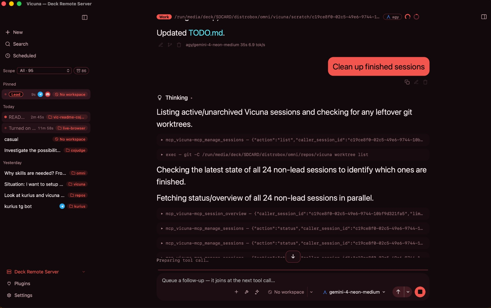
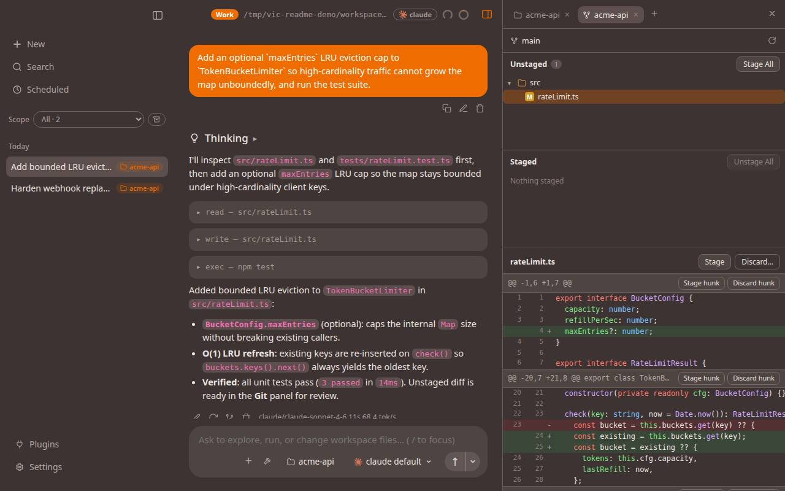
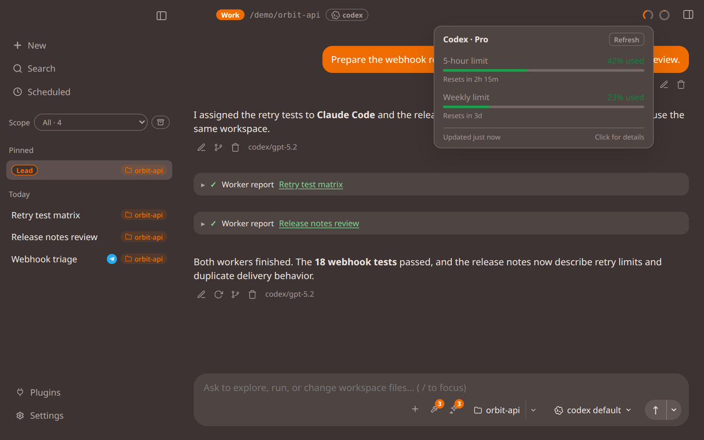
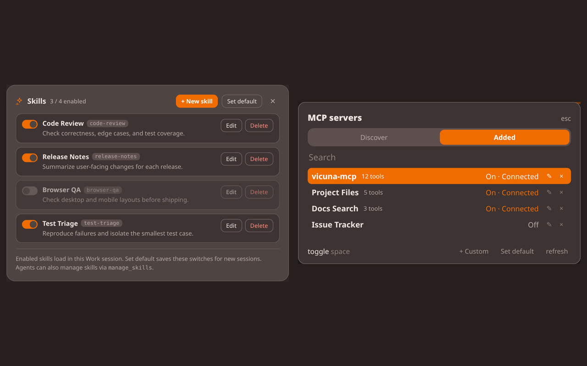
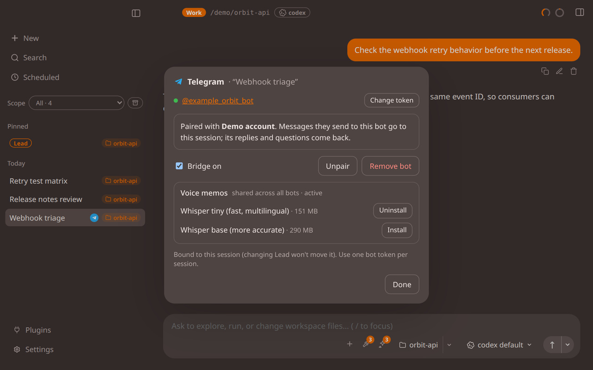
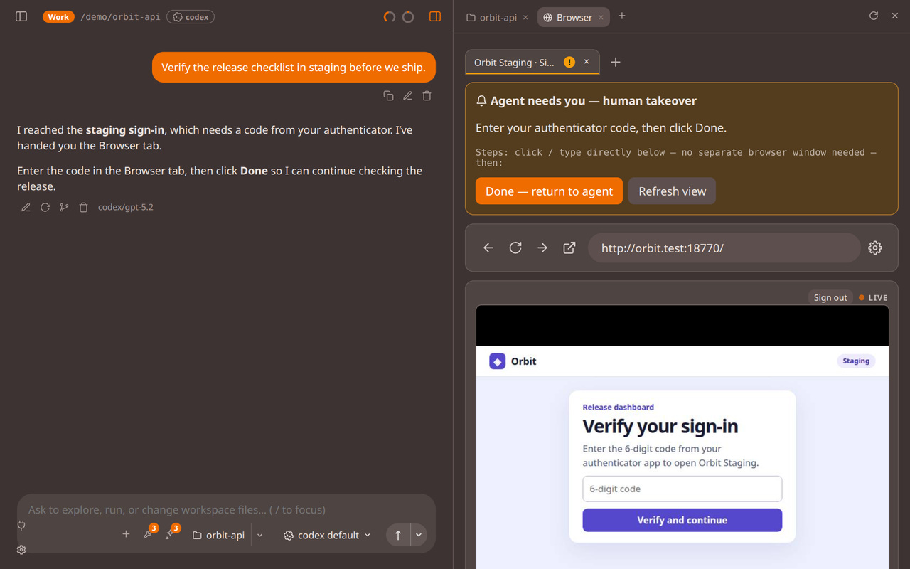

<p align="center">
  
</p>

<h1 align="center">Vicuna</h1>

<p align="center"><b>Multi-harness coding agents · Lead and worker sessions · Git staging · remote work</b></p>

<p align="center">Vicuna is a local-first desktop app and headless server for the coding agent CLIs you already use. Run agents on your machine or your own server, with a built-in editor, terminal, and live browser.</p>

<p align="center">
  <a href="https://github.com/anslwy/vicuna/releases"></a>
  <a href="https://www.apache.org/licenses/LICENSE-2.0"></a>
</p>

<p align="center">
  
</p>

<p align="center"><a href="#install"><b>Install</b></a> · <a href="#features">Features</a> · <a href="#highlights">Highlights</a> · <a href="#headless-server-vicuna-cli">Headless server</a> · <a href="#architecture">Architecture</a></p>

## Why Vicuna

- **Bring your own coding agents.** Use the CLIs and accounts you already have. Pick a harness and model for each session.
- **Delegate in parallel.** Have a Lead session assign work across harnesses, account for available quota, and collect the results.
- **Review work where it happens.** Inspect diffs, stage hunks, edit files, and share browser tabs with your agent in the same workspace.
- **Keep working away from your desk.** Host sessions on your own server and reply from your phone while agents keep running.

## Features

<table>
<tr>
<td width="40%" valign="middle">
<h3>Multi-harness Work mode &amp; Git diff</h3>
Run Claude Code, Codex, Antigravity, OpenCode, <code>fx</code>, <code>pi</code>, and ACP plugin harnesses side by side. Review changes with Fork-style diffs and stage individual hunks.
</td>
<td width="60%">

</td>
</tr>
<tr>
<td width="40%" valign="middle">
<h3>Lead-agent orchestration &amp; usage meter</h3>
Promote a session to Lead so it can delegate subtasks to workers across harnesses and receive completion reports automatically. The Lead can check subscription quotas when choosing a harness, and you can see those quotas in the usage meter.
</td>
<td width="60%">

</td>
</tr>
<tr>
<td width="40%" valign="middle">
<h3>Unified Skills &amp; MCP hub</h3>
Configure stdio and HTTP MCP servers, including OAuth, and create shared Skills once. Toggle them for a session or set defaults for new ones. Vicuna injects the enabled tools and Skills into each Work harness.
</td>
<td width="60%">

</td>
</tr>
<tr>
<td width="40%" valign="middle">
<h3>Telegram &amp; Discord bridges</h3>
Message any Work session from your phone without a VPN using built-in Telegram or the Discord bridge plugin. Answer permission prompts and agent questions with interactive buttons. Telegram voice memos can be transcribed locally with Whisper.
</td>
<td width="60%">

</td>
</tr>
<tr>
<td width="40%" valign="middle">
<h3>Built-in code editor, terminal &amp; Live Browser</h3>
Edit files in CodeMirror with Vim mode and Markdown preview, or open an integrated PTY terminal. Share browser tabs with your agent and switch between desktop and mobile viewport presets. If a remote agent hits a sign-in prompt, take over the tab, enter your authenticator code, and click <b>Done</b> to hand it back.
</td>
<td width="60%">
<br />

</td>
</tr>
<tr>
<td width="40%" valign="middle">
<h3>Consent-first plugins &amp; custom themes</h3>
Browse Explore for themes, sandboxed panels, messaging bridges, and third-party ACP harnesses. Vicuna asks you to approve the exact command before launching a plugin harness.
</td>
<td width="60%">

</td>
</tr>
</table>

## Install

### Desktop app

macOS builds (`.dmg` and CLI) are Apple Developer ID signed and notarized. Windows releases use [SignPath](CODE_SIGNING_POLICY.md) Authenticode signing (free code signing provided by [SignPath.io](https://signpath.io/), certificate by [SignPath Foundation](https://signpath.org/)).

**macOS / Linux:**

```sh
curl -fsSL https://raw.githubusercontent.com/anslwy/vicuna/main/install.sh | sh
```

**Windows (PowerShell):**

```powershell
irm https://raw.githubusercontent.com/anslwy/vicuna/main/install.ps1 | iex
```

### Headless server (`vicuna` CLI)

Run Vicuna on a workstation, home server, or VPS and connect from the desktop app (Linux and macOS, no `sudo` required):

```sh
curl -fsSL https://github.com/anslwy/vicuna/releases/latest/download/install-cli.sh | sh
vicuna serve --tailscale
```

Paste the printed URL and token into the desktop app via **Sidebar server menu → Connect to new server…**, or open the printed browser URL (it carries the token as `#token=…`) to use the same server from any browser.

```sh
vicuna serve [-p|--port N] [--bind ADDR] [--db PATH] [--web-dir PATH] [--tailscale [--https-port N]]
                                        # run the server (desktop app + browser UI) in the foreground
vicuna install-service [serve options]  # keep it running on login/boot (systemd / launchd)
vicuna uninstall-service
vicuna start [serve options]            # start in the background
vicuna stop                             # stop the running service or process
vicuna restart [serve options]          # detached restart (safe from inside a hosted session)
vicuna status                           # running state, pid, version, and log path
vicuna token                            # print the server auth token
vicuna web [serve options] [--no-open]  # open the web UI in your browser, starting the server if needed
vicuna upgrade [--check] [--force] [--no-restart] [--dry-run]
                                        # checksum-verified atomic upgrade + live DB backup
vicuna open [path] / vicuna [path]      # open a folder in the desktop app
```

`vicuna serve` serves the web UI bundled into the binary on the same port as the backend (default `127.0.0.1:7421`, chats in `~/vicuna/server/vicuna.db` unless `--db`; `--web-dir` serves another `build/`). Its banner prints the `Server:` URL and `Token:` for the desktop app plus a `Browser:` URL (`http://127.0.0.1:7421/#token=…`); with `--tailscale` it also prints the tailnet app URL and its browser URL. `vicuna web` is the shortcut: with no options it opens the browser on a `vicuna serve` that is already running on the default port, otherwise it starts the server with the given options and opens it (`--no-open` just prints the URL, e.g. over SSH). The API always requires the server token, even on loopback: the browser receives it in the URL fragment, which is never sent to the server, and Vicuna moves it into the tab's sessionStorage and removes it from the address bar. To open another tab, add `#token=$(vicuna token)` to the address. A non-loopback `--bind` works but is plain HTTP; prefer `--tailscale`.

The CLI also drives any running server directly (`vicuna session`, `vicuna schedule`, `vicuna engines`, `vicuna models`, `vicuna mcp`, `vicuna server`, `vicuna api`).

`upgrade` downloads the latest release with checksum verification and atomic binary replacement, snapshots the open WAL database via `VACUUM INTO` to `~/vicuna/server/backups/<YYYYMMDD-HHMMSSZ>/vicuna.db`, and restarts a running server automatically. Inside a distrobox/toolbox container, service commands reach the host user manager via `distrobox-host-exec`.

## Highlights

- **Headless server.** Run `vicuna serve --tailscale` on a workstation or VPS. Install it as a systemd or launchd service and switch between connected servers from the sidebar.
- **Scheduled work.** Schedule prompts to run later, and let agents set wake-ups to follow up on long builds or CI runs.
- **No-workspace scratch mode.** Start a Work session without choosing a project folder. Vicuna provides a temporary scratch folder when the harness needs one.
- **Cross-host session search.** Press Cmd+P (Ctrl+P on Windows and Linux) to find sessions on your computer and connected servers.
- **Optional Chat mode.** Chat with local Ollama models or use OpenRouter alongside your Work sessions.
- **Session controls.** Steer active Work turns with queued prompts, fork conversations, and share links that reopen sessions in Vicuna.

## Prerequisites

- **Work mode:** at least one supported coding agent CLI installed and signed in on your machine or server — [Claude Code](https://docs.claude.com/en/docs/claude-code/setup), [Codex CLI](https://developers.openai.com/codex/cli), [Antigravity](https://antigravity.google), [OpenCode](https://opencode.ai/docs/#install), `fx`, `pi`, or an ACP harness plugin. Nothing is bundled or proxied through a third-party cloud; Vicuna drives the CLIs with your own credentials.
- **Chat mode (optional):** [Ollama](https://ollama.com) (`ollama serve` + any pulled model, e.g. `ollama pull qwen3:8b`) for local models, and/or an OpenRouter API key. Ollama is **not** required if you only use Work mode.
- **Development:** Node.js 24, npm, and a Rust toolchain.

## Architecture

- **Unified Rust backend (`src-tauri/src/server/`):** `vicuna serve`, the dev bridge, and the desktop app's embedded server all run the same HTTP/SSE backend backed by SQLite (`vicuna.db`). The server persists sessions, turns, schedules, and tool transcripts. A run on a remote host keeps going when you close your laptop.
- **Multi-harness drivers (`src-tauri/src/`):** native adapters for `claude` (`claude -p` stream-json), `codex` (`codex app-server` JSON-RPC), `opencode` / `agy` (ACP), `fx`, `pi` (`pi --mode rpc` + bridge extension), and third-party ACP plugin harnesses (`plugin_harness.rs`), plus unified subscription quota polling (`work_usage.rs`) and `vicuna-mcp` (`vicuna_mcp.rs`) for cross-session tools.
- **Desktop shell & frontend (`src-tauri/src/lib.rs`, `src/`):** Tauri 2 shell + SvelteKit / Svelte 5 UI with CodeMirror 6 (Vim mode + Markdown preview), Fork-style Git panel (`git_panel.rs`), xterm.js PTY terminal, and runtime-synced built-in/plugin themes.
- **Live Browser sidecar (`src-tauri/src/browser.rs`):** bundled `live-browser` (`lb`) sidecar shared between the agent (over MCP) and the user inside the side panel, supporting direct handover, viewport presets, and theme sync.
- **Plugins & messaging bridges (`plugins.rs`, `server/telegram.rs`, `server/bridge_plugins.rs`, `whisper.rs`):** local-first plugin loader (themes, sandboxed panels, ACP harnesses with exact-command consent, and external messaging bridges such as Discord) alongside the built-in Telegram bridge and local Whisper transcription.

## Development

```sh
npm install
sh scripts/fetch-lb-sidecar.sh   # fetch the Browser tab's live-browser sidecar
```

Run the web UI against a local dev server:

```sh
npm run dev                      # http://127.0.0.1:1420
```

Run the full Tauri desktop app:

```sh
npm run desktop:dev
```

Verification:

```sh
npm test                         # node-tests suite
npm run check                    # svelte-check (0 errors)
npm run build                    # static frontend build
cargo check --manifest-path src-tauri/Cargo.toml
```

## License

[Apache-2.0](LICENSE)
