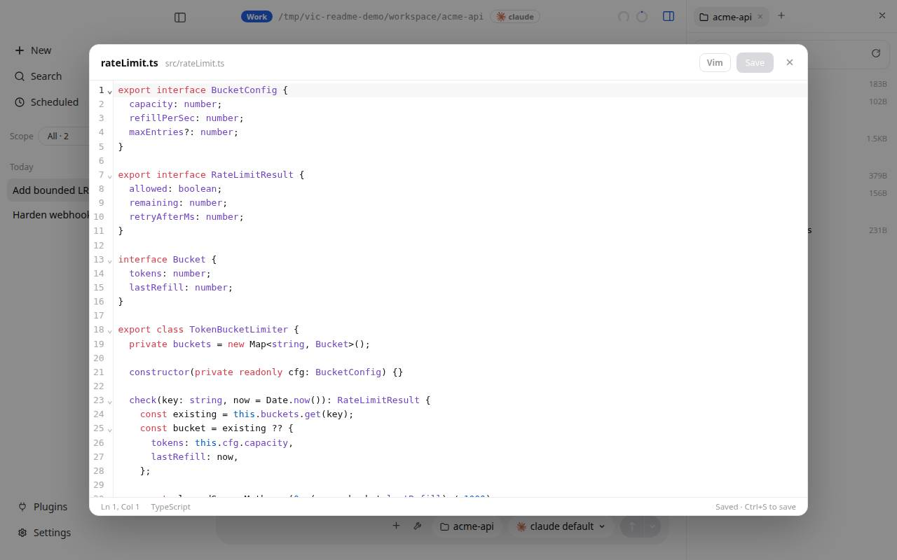
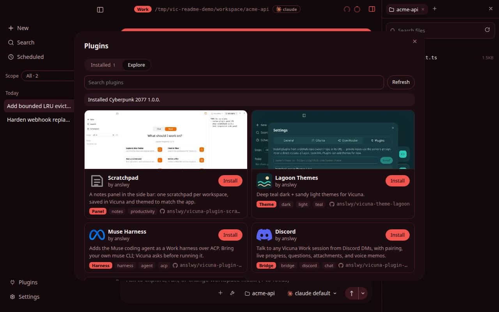
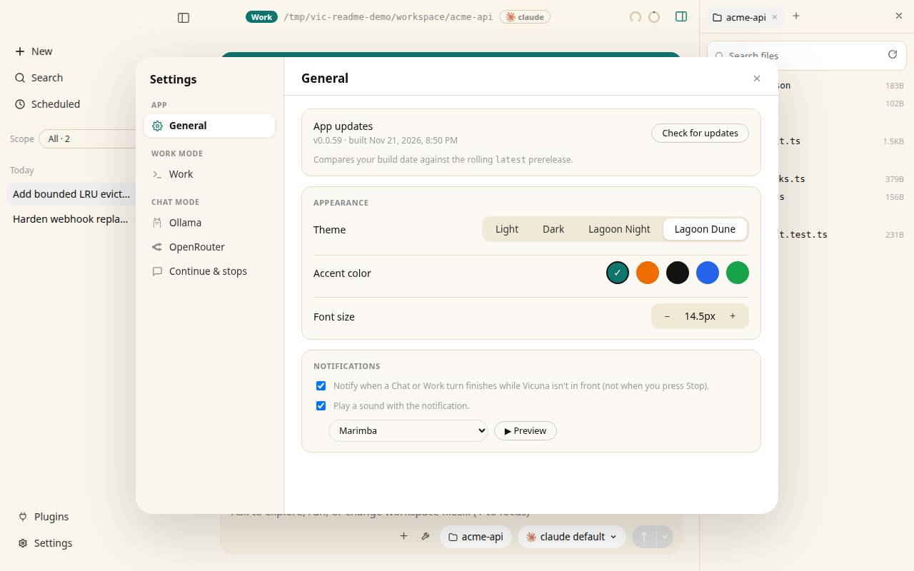

# Vicuna

**Local-first desktop app and headless server for the coding agent CLIs you already use.**

Drive Claude Code, Codex, Antigravity, OpenCode, `fx`, `pi`, and ACP plugin harnesses from one native cross-platform interface — with built-in Git diff, code editor, terminal, live browser, MCP hub, and mobile bridges. Optional **Chat mode** supports local [Ollama](https://ollama.com) and OpenRouter models.

|  |  |
|:---:|:---:|
| Work mode + Fork-style Git diff | Built-in code editor with Vim mode |
|  |  |
| Plugins Explore marketplace | Settings & custom themes |

## Highlights

- **One client for your coding CLIs** — run Claude Code, Codex, Antigravity, OpenCode, `fx`, `pi`, and ACP plugin harnesses side by side with per-session harness/model selection and a unified subscription usage meter.
- **Unified MCP hub** — configure stdio and remote HTTP MCP servers once (including OAuth) and Vicuna auto-injects them into every Work harness.
- **Headless server & remote work** — run `vicuna serve --tailscale` as a systemd or launchd service so agents keep working with your laptop closed; switch across multiple servers from the sidebar and schedule wake-ups.
- **Built-in IDE side panels & Live Browser** — syntax-highlighted file editor (CodeMirror, Vim mode, Markdown preview), Fork-style Git staging and hunk diffs, integrated PTY terminal, and a collaborative live browser with desktop/mobile viewport presets, all synced to your active theme.
- **Per-session Telegram & Discord bridges** — message any Work session from your phone without a VPN, answer permission/question cards with interactive buttons, and send voice memos transcribed locally via Whisper.
- **Lead / Worker multi-agent orchestration** — promote a session to Lead to delegate subtasks to worker sessions across harnesses, with quota-aware harness selection and automatic completion reporting.
- **Consent-first plugin system** — browse the built-in Explore marketplace for themes, sandboxed side panels, messaging bridges, and third-party ACP harnesses gated behind exact-command approval.

## Install

### Desktop app

macOS builds (`.dmg` and CLI) are Apple Developer ID signed and notarized.

**macOS / Linux:**

```sh
curl -fsSL https://raw.githubusercontent.com/anslwy/vicuna/main/install.sh | sh
```

**Windows (PowerShell):**

```powershell
irm https://raw.githubusercontent.com/anslwy/vicuna/main/install.ps1 | iex
```

### Headless server (`vicuna` CLI)

Run Vicuna on a workstation, home server, or VPS and connect from the desktop app (Linux and macOS, no `sudo` required):

```sh
curl -fsSL https://github.com/anslwy/vicuna/releases/latest/download/install-cli.sh | sh
vicuna serve --tailscale
```

Paste the printed URL and token into the desktop app via **Sidebar server menu → Connect to new server…**.

```sh
vicuna serve [--port N] [--bind ADDR] [--db PATH] [--tailscale [--https-port N]]
                                        # run the server in the foreground
vicuna install-service [serve options]  # keep it running on login/boot (systemd / launchd)
vicuna uninstall-service
vicuna start [serve options]            # start in the background
vicuna stop                             # stop the running service or process
vicuna restart [serve options]          # detached restart (safe from inside a hosted session)
vicuna status                           # running state, pid, version, and log path
vicuna token                            # print the server auth token
vicuna upgrade [--check] [--force] [--no-restart] [--dry-run]
                                        # checksum-verified atomic upgrade + live DB backup
vicuna open [path] / vicuna [path]      # open a folder in the desktop app
```

The CLI also drives any running server directly (`vicuna session`, `vicuna schedule`, `vicuna engines`, `vicuna models`, `vicuna mcp`, `vicuna server`, `vicuna api`).

`upgrade` downloads the latest release with checksum verification and atomic binary replacement, snapshots the open WAL database via `VACUUM INTO` to `~/vicuna/server/backups/<YYYYMMDD-HHMMSSZ>/vicuna.db`, and restarts a running server automatically. Inside a distrobox/toolbox container, service commands reach the host user manager via `distrobox-host-exec`.

## Prerequisites

- **Work mode:** at least one supported coding agent CLI installed and signed in on your machine or server — [Claude Code](https://docs.claude.com/en/docs/claude-code/setup), [Codex CLI](https://developers.openai.com/codex/cli), [Antigravity](https://antigravity.google), [OpenCode](https://opencode.ai/docs/#install), `fx`, `pi`, or an ACP harness plugin. Nothing is bundled or proxied through a third-party cloud; Vicuna drives the CLIs with your own credentials.
- **Chat mode (optional):** [Ollama](https://ollama.com) (`ollama serve` + any pulled model, e.g. `ollama pull qwen3:8b`) for local models, and/or an OpenRouter API key. Ollama is **not** required if you only use Work mode.
- **Development:** Node 18+, npm, and a Rust toolchain.

## Architecture

- **Unified Rust backend (`src-tauri/src/server/`):** `vicuna serve`, the dev bridge, and the desktop app's embedded server all run the same HTTP/SSE backend backed by SQLite (`vicuna.db`). Sessions, turns, schedules, and tool transcripts are persisted server-side so closing the window or laptop never interrupts an active run.
- **Multi-harness drivers (`src-tauri/src/`):** native adapters for `claude` (`claude -p` stream-json), `codex` (`codex app-server` JSON-RPC), `opencode` / `agy` (ACP), `fx`, `pi` (`pi --mode rpc` + bridge extension), and third-party ACP plugin harnesses (`plugin_harness.rs`), plus unified subscription quota polling (`work_usage.rs`) and `vicuna-mcp` (`vicuna_mcp.rs`) for cross-session tools.
- **Desktop shell & frontend (`src-tauri/src/lib.rs`, `src/`):** Tauri 2 shell + SvelteKit / Svelte 5 UI with CodeMirror 6 (Vim mode + Markdown preview), Fork-style Git panel (`git_panel.rs`), xterm.js PTY terminal, and runtime-synced built-in/plugin themes.
- **Live Browser sidecar (`src-tauri/src/browser.rs`):** bundled `live-browser` (`lb`) sidecar shared between the agent (over MCP) and the user inside the side panel, supporting direct handover, viewport presets, and theme sync.
- **Plugins & messaging bridges (`plugins.rs`, `server/telegram.rs`, `server/bridge_plugins.rs`, `whisper.rs`):** local-first plugin loader (themes, sandboxed panels, ACP harnesses with exact-command consent, and external messaging bridges such as Discord) alongside the built-in Telegram bridge and local Whisper transcription.

## Development

```sh
npm install
sh scripts/fetch-lb-sidecar.sh   # fetch the Browser tab's live-browser sidecar
```

Run the web UI against a local dev server:

```sh
npm run dev                      # http://127.0.0.1:1420
```

Run the full Tauri desktop app:

```sh
npm run desktop:dev
```

Verification:

```sh
npm test                         # node-tests suite
npm run check                    # svelte-check (0 errors)
npm run build                    # static frontend build
cargo check --manifest-path src-tauri/Cargo.toml
```

## License

MIT
